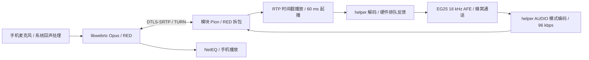

# 云端通话音频重构：离线候选版，2026-11-05

后续发布：用户同日选择跳过进一步真机测试直接发布。代码已合入 main，23:31 已发布网页 Engine；TestFlight 状态见[发布记录](CLOUD_AUDIO_DEPLOYMENT_20261105.md)。以下保留此前离线验证时的范围与边界。

用户反馈云端双向通话断续、吞字、失真或发闷，要求提高音质、抗干扰与实时性；EG25 暂时无法接回，因此本轮完成源码重构、离线验证和本地 Engine 包。没有发布网站、ECS 或 TestFlight，没有安装模块，也没有采集真实通话音频。

候选 Agent 为 `2.0.0-dev.audio1`，helper 为 `0.6.1-opus`，工作分支 `codex/cloud-audio-rebuild`。生产状态仍以此前发布记录为准。机器可读结果、源码摘要和包摘要见 [验证证据](CLOUD_AUDIO_REBUILD_20261105.json)。

## 方案及改动



- **保留可用的声音细节**：模块输入是已解码的蜂窝语音，编码器从 `OPUS_APPLICATION_VOIP` 改为 `OPUS_APPLICATION_AUDIO`，避免再次应用 VOIP 输入高通整形。保留 16 kHz、96 kbps VBR、20 ms、定点复杂度 3、带内 FEC、DTX 关闭。手机原始麦克风仍使用系统 voiceChat 与既有回声处理。Opus 仍是有损编码；16 kHz 来源无法通过传输产生本来不存在的高频。
- **用带宽补回原包**：协商 RFC 2198 `audio/red`，每包附带最多两份此前的完整 Opus 包，不重新编码副本。以额外 40 ms 的时间跨度保护连续丢两包；仍需后续包赶在播放截止时间前到达。按 240 字节主包计算，带两份副本为 729 字节 RED 载荷，含常见网络头每方向预算约 0.32 Mbps。VBR 和 MTU 可能减少副本数量，不能保证所有网络下都恢复两包。
- **按采样时间播放**：保留 48 kHz RTP 时间戳，64 格有界缓存，60 ms 起播；原包与 RED 副本去重。每个截止时间都前进，晚到旧音频不再拖后播放。找不到原包时才尝试下一包 FEC，再用 PLC；FEC 计数是尝试次数，不是成功恢复证明。
- **停顿后回到当前声音**：取消积压后按 5 ms 间隔追播。持续欠载／持续领先时，确认连续的最新主包后重建有限时间线，并记录 `playout_resyncs`。ASMP 采集缺口推进 RTP 时间戳，RTP 序号只计实际发送包；采集 xrun 至少暴露一个缺失帧，驱动重置丢失的精确时长不推测。
- **限制硬件预填**：helper 根据 ALSA DELAY 等待排队量降至 40 ms 或硬件起播阈值，再取下一帧解码写入。EG25 16 kHz 下写入后目标约为 60 ms；256×8 的物理声卡缓冲配置保持。DELAY 不支持或不可信时使用原有写入路径，硬件时钟停止前进则两秒内结束。这一策略的实际固件表现尚未验证。

核心文件：

| 范围 | 文件 |
| --- | --- |
| App 初始化、RED 深度与离线依赖注入 | `iOS/AirSIM/CloudV2/V2WebRTC.swift` |
| SDP 协商、RED 封装与校验、RTP 时间戳 | `module/airsim-agent/internal/rtc/{peer,red}.go` |
| 时间戳播放、恢复与计数 | `module/airsim-agent/internal/cloud/{bridge,jitter}.go` |
| 模块编码模式、采集缺口与声卡预填 | `module/rm500/audio/src/{opus_codec,audiod}.c`，两种模块共用 |
| 验证 | 同目录 Go/C 测试，`internal/cloud/impairment_test.go`，`scripts/verify_ios_audio.py` 与 `scripts/ios_audio_probe/` |

## 离线证据

iOS 模拟器使用仓库中的实际 `V2WebRTC.swift`、WebRTC 155.0.0 与实际 Pion `rtc.Answer`，通过注入合成音频设备完成双向 ICE／DTLS／SRTP：App 收到 160 包，模块收到 109 个主包，其中 107 包包含两份冗余，非法音频包为零。测试没有打开麦克风或扬声器。另有本地 TURN 的 UDP/TCP、纯 Opus/RED 四种组合通过双向转发测试；这不是生产蜂窝网络验收。

确定性虚拟时间测试使用 20 ms 帧、固定 30 ms 单向基础传输延迟和指定随机种子，检查实际播放帧 ID 不倒退。以下为启用两份冗余的结果。数据是包连续性，不是听感评分；播放时延只到 Go bridge，未包含 helper、声卡、App、编解码与蜂窝电话网。

| 场景 | 源帧数 | 精确播放 | RED 恢复 | Go 播放时延 p95 |
| --- | ---: | ---: | ---: | ---: |
| 无干扰 | 3000 | 3000 | 0 | 90 ms |
| 3% 随机丢包＋0–15 ms 抖动 | 3000 | 3000 | 93 | 90 ms |
| 10% 随机丢包＋0–15 ms 抖动 | 3000 | 2997 | 308／311 个丢包 | 90 ms |
| 每秒连续丢两包＋0–15 ms 抖动 | 3000 | 3000 | 120 | 90 ms |
| 0–55 ms 抖动／乱序 | 3000 | 3000 | 0 | 90 ms |
| 0–120 ms 抖动 | 3000 | 2987 | 12 | 190 ms，一次重同步 |
| 网络中断 200 ms | 3000 | 2992 | 2 | 90 ms |
| 调度停顿 120 ms | 3000 | 2994 | 0 | 90 ms，跳过六个过期帧 |
| 链路延迟永久增加 120 ms | 3000 | 2998 | 0 | 210 ms，一次重同步 |
| 30 分钟、发送时钟慢 150 ppm | 90000 | 89988 | 0 | 105 ms，三次重同步 |
| 30 分钟、发送时钟快 150 ppm | 90000 | 89984 | 0 | 183 ms，两次重同步 |

这些比例只适用于测试条件。对同一条模拟轨迹，纯 Opus 比较项也使用新时间戳缓冲；不是与旧生产缓冲算法的全链路 A/B 比较。

原生合成谐波测试中，AUDIO 模式延时对齐后的 SNR 从 4.5 dB 变为 31.1 dB，相关系数从 0.819 变为约 1.000；平均载荷 182.4 字节，算法延时约 104 个 16 kHz 样本。这个测试检测额外的波形整形，不能解释成真实语音降噪提升 26.6 dB 或主观 MOS。FEC 恢复误差仍低于 PLC。真实蜂窝输入可能已被窄带编码、增益削顶或底噪损坏，网络层不能恢复这些细节。

其他验证：

- Agent `go test -race ./...` 通过；最终改动的 cloud/rtc/media 竞态回归及 `go vet` 通过。
- RED 解析器 20 秒 fuzz，1,161,063 次执行，无失败；覆盖错误长度、类型、时间偏移、Opus 时长和回绕。
- iOS CloudV2Tests 108 项通过，排除需要真实 Keychain 环境的测试；真实 SDK 对接测试另行通过。
- 原生 ASan/UBSan 测试通过，包括 Opus/FEC/PLC、xrun 采集缺口、分段 I/O、EG25 预填策略、不可用 DELAY 回退与硬件时钟停顿预算。上游 PCM 状态回归的旧实现作为预期失败对照保留。
- EG25 ARMv7 与 RM500 ARM64 静态 helper、对应 Go Agent 均完成构建。两平台网页包的共 21 个清单文件全部通过长度与 SHA-256 核对，包含许可证。

## 本地包与兼容性

离线包位于 `/tmp/airsim-cloud-audio-20261105/engine/`，摘要见 JSON 证据。EG25 Agent 为 11,141,304 字节、helper 为 332,200 字节；RM500 Agent 为 11,272,376 字节、helper 为 396,456 字节。这些产物没有上传网页或安装到设备。

RED 经 SDP 协商，未提供匹配 RED 的对端退回纯 Opus。既有 WebRTC 155 App 已提供 RED，但要让 App 发送两份副本需更新本次 App 源码；旧 App 的默认冗余深度不能当作本轮双包保护验收。ASMP v3、helper JSON、业务 `codec:"opus"`、所有权和信令 API 保持兼容，ECS 继续透明转交 SDP 与 TURN 数据，本轮没有云端业务代码变更。Agent 的本机诊断新增 `red_recovered_frames`、`invalid_audio_packets`、`duplicate_audio_packets`、`playout_resyncs`，App 不直接消费该 Unix 本机诊断接口。

后续发布应将 Agent/helper 成对构建和切换，并更新 App；不要在活动通话中切换。网页安装器沿用此前已发布的低空间重装逻辑。主分支和生产环境尚未包含本轮候选版，未生成新 TestFlight 构建。

## 真机边界与下一轮验收

本轮完成的是可复现的离线候选版。EG25 接回后仍需走云端双向通话，确认 ALSA DELAY 真实含义、实际硬件排队、CPU/RAM、采集／播放 xrun、RED 恢复与 PLC、App NetEQ 延迟、双向听感和端到端时延；USB 仅可用来读计数，不把本地直连当云端验收。

目前时钟偏差通过有界重同步处理，可能短暂补偿或跳过音频，尚不是采样级无感漂移匹配。RED 固定副本会增加带宽；本轮没有加入基于 RTCP/TWCC 的端到端自适应码率控制，在带宽不足或持续长突发丢包时不能保证音质与低延迟同时维持。没有真实设备证据前，不声称用户的双向听感问题已经完全消失。

## 复现与依据

```sh
cd module/airsim-agent
go test -race ./...
go test ./internal/cloud -run TestCloudAudioImpairments -v -count=1
go test ./internal/rtc -run '^$' -fuzz FuzzDecodeRED -fuzztime=20s
python3 scripts/verify_ios_audio.py --derived-data <已有模拟器构建目录> --simulator <已启动模拟器UUID>
```

原生验证用 `sh module/rm500/audio/scripts/test.sh`；交叉编译与网页包构建沿用各组件 README。模拟器对接需要带有 WebRTC.framework 的既有 DerivedData；它运行独立进程、生成内存中的合成音频并只输出阶段和计数。

设计依据：[RFC 2198 冗余音频](https://www.rfc-editor.org/rfc/rfc2198.html)、[RFC 8854 WebRTC FEC](https://www.rfc-editor.org/rfc/rfc8854.html)、[RFC 7587 Opus RTP](https://www.rfc-editor.org/rfc/rfc7587)、[Opus 编码控制](https://www.opus-codec.org/docs/opus_api-1.5/group__opus__encoderctls.html)。软件的精确行为以本仓库固定版本源码与测试为准。
