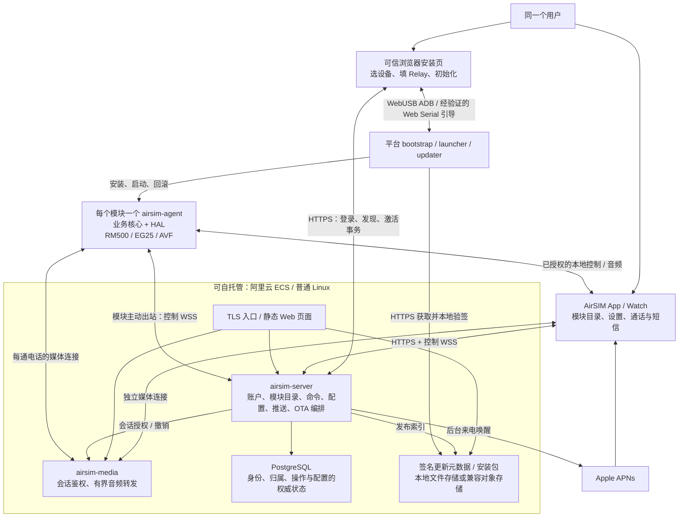
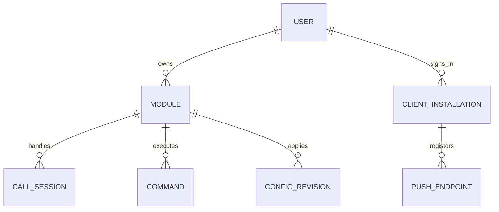

# AirSIM 系统架构：个人多模块、浏览器初始化与自托管 Relay

日期：2026-10-24。状态：产品级目标架构，尚未完成端到端实现。RM500 新 Agent 的 R1–R3 已通过限定范围本地实机验收，见 [执行记录](RM500_AGENT_EXECUTION.md)；R4 Agent/ECS 云端接入按 [公共契约](../protocol/v2/R4.md) 实施中，App 已于 2026-10-30 确定使用 v2 唯一入口。用户已确认：**一个用户、多个模块、不共享**。手机与 Watch 是同一用户的客户端；RM500、EG25 和 Android AVF 是被管理的终端。本文定义产品级边界；模块内部实现见 [Agent / HAL 架构](../module/ARCHITECTURE.md)，EG25 约束见 [实机审查](../module/DEVICE_SURVEY.md)。

2026-10-24 主控更新：用户确定新 Agent 名为 `airsim-agent`，在 `module/airsim-agent/` 独立建设；旧 `module/module-agent/` 保留。新 ECS 服务端放在 `service/airsim/`，先做 ECS + Docker Compose，部署入口为 `service/airsim/deploy/compose/`。Cloudflare Worker v2 独立放在 `service/airsim-worker/`，旧版保留在 `push-relay-worker/`。App 启用云端时明确选择 v1 或 v2，v2 两种服务实现共用对外协议。以下目录、拆分与兼容边界取代此前原地重构旧 Agent、自动选择云端主版本及 ECS 首版承担完整 v1 兼容层的设想；总体架构按下述边界实施；当前R4代码开发与实测进度见 [主控计划](RM500_AGENT_R4.md)，不能把目标设计视为已验收。

## 1. 核心决策与整体拓扑

采用浏览器安装器、模块化单体 Agent、可自托管控制服务、独立媒体中继和独立更新器。新模块端采用 Go + HAL；新云端采用 Go，首版运行于 ECS + Docker Compose，不依赖 Workers、KV 或 Durable Objects。账户、设备目录、命令、配置和发布任务在一个控制服务内；媒体按资源和故障边界独立进程。首版不增加 MQTT broker、Redis、Kafka、Kubernetes 或每项业务一个微服务。



客户端到 ECS 的连接统一经过 TLS 入口，图中到逻辑服务的线表示业务路由，不开放其内部监听端口。RM500 CLI 是独立诊断工具，不参与安装器、Agent 或 Relay 的调用链。

浏览器安装器是操作者电脑上的工具，不是在尚未安装 Agent 的模块上运行一个网站。日常 Web 控制台可与安装页共用前端工程，但只有进入初始化流程并获得 USB 授权时才接触设备；普通远控走 HTTPS/WSS。

## 2. 现有实现为什么需要演进

以下结论来自当前源码，不代表新方案已经实现：

| 当前事实 | 产品化影响 |
| --- | --- |
| [AppModel.swift](../iOS/AirSIM/AppModel.swift) 已合并本地/云端 Agent 列表，但 current agent 还会取 active_agent_id 或第一个在线实例 | 可以复用展示基础；必须增加明确的目标模块选择与按模块隔离的状态，不能用最新心跳决定拨号目标 |
| [VoIPPushController.swift](../iOS/AirSIM/VoIPPushController.swift) 由客户端 secret 派生 device_id，并发送含设备 secret 的注册 | 客户端身份、模块身份和所有权需要分开；手机重装不应改变模块归属 |
| [Relay 注册与命令](../push-relay-worker/src/index.mjs) 以 device_id 组织认证、命令 DO 和推送字段；命令入队未绑定独立 module_id | 多 Agent 状态可见，不等于命令能安全地定向到多个模块 |
| 注册记录保存一组 voip_token / alert_token / watch_voip_token | 同一用户多个手机必须分别保存客户端安装实例和推送 token，不能互相覆盖 |
| Relay 使用 KV、Durable Objects、WebSocketPair | ECS 迁移需要替换状态所有权和运行时适配，不能直接把 Worker 放进容器就算完成 |
| 旧 Agent 的 main 仅允许 AVF；新 `module/airsim-agent` 已完成 RM500 R1/R2 与 R3 本地音频闭环；EG25 经 ECS 与 iPad 的 16 kHz LC3 真实来电已实测双向连贯，长时间通话与 RM500 云端端到端尚未验收，见 [R3 主控记录](RM500_AGENT_R3.md) 与 [EG25 验收记录](../module/eg25/TESTING.md) | Web 安装器必须按平台及已验收能力检查，不能把“文件传输成功”展示为安装完成 |

## 3. 身份与归属：一个主人、多个模块

### 3.1 数据模型



每台模块只有一个 `owner_user_id`，不设计共享、邀请、团队角色或多人 ACL。首版个人自托管可只开放一个主人账户，后台管理凭据仍与 App 客户端凭据分开。

首版主路径让同一用户的模块使用同一 Relay，账户登录一次即可汇总。App 的模块主键仍包含 `(server_id, module_id)`，避免以后接入第二个自建 Relay 时碰撞；不同 Relay 分别登录、分别保存凭据，不根据相同邮箱/名称自动合并身份或建立跨服务器信任。

| 标识 | 含义与生命周期 |
| --- | --- |
| server_id | 一套 Relay 的逻辑身份；域名是连接地址，不是模块身份。重建为不同服务不能伪装成旧服务 |
| user_id | 主人账户；换手机后重新登录恢复模块目录 |
| module_id | 一次模块入网身份；由模块生成密钥并完成持有证明后登记，独立于 SIM、IP、ADB 序列号和手机号 |
| client_installation_id | 每个 App/Watch 安装实例；独立登录会话、撤销状态与推送端点 |
| agent_boot_id / connection_epoch | 每次 Agent 启动和连接的代次，用于识别迟到事件与旧连接 |
| sim_epoch | SIM 更换的代次；用于区分短信/注册状态，不改变 module_id 的归属 |
| call_id / generation | 唯一通话及其会话代次；永久绑定 module_id、客户端、媒体授权和本次 transport |

模块密钥在设备内生成并持久化，升级保留；设备编号不使用 IMEI/ICCID/手机号作为公开主键。没有硬件密钥保护时，文件权限只能降低软件误用风险，不能宣称能防止 root/物理提取。备份不得向另一块模块克隆设备私钥。

App 凭据按 `(server_id, user_id, client_installation_id)` 保存在 Keychain。模块使用自己的客户端证书/设备密钥；不向手机复制模块的长期私钥，也不让模块保存用户密码或所有手机的凭据。

### 3.2 登录与恢复

提供一个可自托管的账户入口：优先 Passkey，并提供明确的恢复码/受控恢复流程；使用成熟实现，不自己设计密码学。App 登录采用系统浏览器的标准授权码 + PKCE 流程，浏览器控制台使用受保护会话 cookie 和 CSRF 防护。已有 OIDC 可作为可选身份适配，不强制额外部署一个身份微服务。原生 App 外部浏览器登录遵循 [RFC 8252](https://www.rfc-editor.org/rfc/rfc8252)。

用户换手机只需登录同一 Relay 账户并注册新的推送端点；模块不用重装或重新输入 secret。丢失手机后撤销该安装实例的会话、推送和本地授权，新手机不会继承旧手机的访问 token。

解除绑定、恢复出厂和重新安装是不同操作。普通重装保留设备身份与归属；恢复出厂后必须创建新身份并重新激活，不能仅凭相同硬件编号自动继承旧主人。旧记录显示失联/已移除。无共享需求也必须保留明确的退役流程，避免把“解除绑定”变成远程抢占入口。

## 4. 浏览器初始化：尽量少操作，但不能省掉根本前提

### 4.1 产品体验

目标主路径：**电脑插入模块 → 打开可信安装页 → 填一次 Relay 地址并登录 → 选择设备 → 点击初始化 → App 自动出现模块。** 已登录同一账户时不再单独扫码配对；未登录浏览器时可用 App 扫码批准一次有范围、短时有效的初始化会话，页面同时显示账户、模块和 Relay，避免仅凭扫码截图获得所有权。

首版保证的是经测试的桌面 Chrome/Edge + 操作系统/驱动组合。手机浏览器可登录管理控制台，不承诺 iPhone 浏览器能直接安装 USB 模块。WebUSB 需要安全上下文和用户手势，Web Serial 也要求用户选择端口；这些授权点击无法由网页偷偷完成。[Chrome WebUSB](https://developer.chrome.com/docs/capabilities/usb)、[Web Serial](https://developer.chrome.com/docs/capabilities/serial)。浏览器 ADB 可评估作者维护的 [ya-webadb](https://github.com/yume-chan/ya-webadb)，具体固件兼容需实测。

安装页是独立受信的发行入口，可由受信的自托管站点提供。Relay 地址仅配置运行服务，不允许它任意更换安装页脚本、发行公钥或上传可执行脚本。网页本身拥有 USB 管理能力，其来源受信是首次安装的前提；包验签不能弥补被接管的初始化网页。安装页避免第三方脚本，设置严格 CSP，并提供版本固定的离线发行方式。

### 4.2 “网页开启 ADB”的三种情况

| 设备状态 | 安装器行为 |
| --- | --- |
| ADB 已枚举 | 用户选择对应 USB 设备，按固件要求完成认证；探测型号、版本、架构、持久空间与权限 |
| ADB 关闭，但受支持的 AT 串口开放 | 经 Web Serial 获得该端口；只对型号/固件白名单执行已验证的开启操作，等待 USB 重枚举，再重新确认设备 |
| 无 ADB、无可访问 AT，或只能用厂商下载接口 | 显示所需的物理操作、驱动或厂商引导流程；不能承诺网页能无条件开启 ADB，也不自动进入刷基带/恢复模式 |

RM500U 与 EG25 必须有独立的 bootstrap profile，明确 VID/PID、固件匹配、权限、开启/关闭 ADB 的方法及回退。当前两台样机曾能通过 ADB 访问，只证明 ADB 已开放；尚未验收“关闭 → 浏览器开启 → 安装 → 收回调试权限”的完整过程。不能照搬不同型号的 QCFG 参数。USB 重枚举后不能盲选第一个设备，尤其 EG25 当前没有 ADB 序列号。

Android AVF 走独立流程：手机开发者选项/ADB 授权、Android App 权限、AVF 生命周期和 Debian installerd 各有前提。网页不能绕过 Android 的开发者选项与主机授权，也不能把手机 ADB shell 当作已进入 AVF Linux。[Android ADB 文档](https://developer.android.com/tools/adb)。

浏览器遇到本机 ADB server 抢占 USB、Windows 驱动不匹配或不支持 WebUSB 时，提供明确诊断。必要时采用可选、签名的本地 USB bridge；bridge 只绑定 loopback、校验 Origin 和单次会话，不提供公共任意 shell。首版不要求每个人先安装 bridge。

### 4.3 初始化状态机与安装成功标准

```text
selected → inspected → bootstrap_ready → package_verified → installed
         → identity_created → binding_pending → bound
         → agent_connected → health_verified → ready
```

每一步以 `provisioning_tx_id` 记录可恢复结果，刷新网页/拔线后重新读设备与服务端状态，不重建身份、不重复接管所有权。设备日志只保存脱敏阶段和错误码。

安装器在写入前检查实际 CPU、内核、厂商 ABI、可写持久目录、安装空间和启动入口。选择精确匹配的签名包；平台不匹配或空间不足就停止。用 ADB 传送小型 bootstrap/安装包，设备侧验证后再激活；bootstrap 与稳定 launcher/updater 属于安装基础设施，独立于 Agent，也不调用 RM500 CLI。

**长期最佳方案是把稳定 bootstrap/launcher/updater 与发行信任根集成进目标固件，Agent 本体通过网页首次安装和后续 OTA 交付。** RM500/EG25 的根文件系统只读；没有受支持的启动 hook 时，上传二进制只能算手动运行，不能报告永久安装完成。对原厂固件必须建立适配白名单；需要更换基础固件的型号应明确标记为前置步骤，不能在普通初始化里隐式 remount 或刷写。

成功需分别呈现：安装完成、绑定完成、模块到 Relay 联通、SIM/注册状态、语音能力。无 SIM 或尚未联网可完成安装及 USB 绑定，显示“已绑定，待模块联网”；不能因为电脑能访问 Relay 就宣告模块云端可用。没有启动/重启验证时也不能显示“开机可用”。

最后在已验证启动、恢复和重连后，按固件支持关闭临时 ADB 或撤销临时主机授权；保留经验证的物理恢复方式。没有恢复入口的样机阶段，不能为了界面显示安全而贸然关掉唯一管理通道。日常远控不依赖 ADB，不开放公网 ADB。

### 4.4 Relay 地址与激活事务

用户输入 HTTPS Relay 基地址，浏览器读取拟定的 `/.well-known/airsim`，显示 server_id、服务名称、API/媒体版本、登录入口、设备连接地址、APNs 策略和兼容能力。自建服务配置允许的安装页 Origin；CORS 不等于鉴权。拒绝 URL 内嵌凭据、无关跨域重定向、把秘密拼进 URL，以及绕过证书错误。设备/媒体/更新端点限定为部署者明确配置的 HTTPS 来源，并在激活时绑定；主机名允许合法自托管地址，浏览器和模块分别做网络探测。

激活同时证明两件事：主人已经登录、当前 USB 设备持有对应私钥。推荐流程：

1. 浏览器在已登录账户下创建短期 enrollment intent，绑定 server_id、provisioning_tx_id 和浏览器会话。
2. 模块生成设备密钥，把公钥和针对该事务的随机挑战签名经 USB 交给浏览器；私钥不离开模块。首次注册不把未经认证的型号字段视为硬件证明。
3. Relay 原子保留该 module_id 的主人关联，返回绑定公钥、账户、server_id、期限的 pending enrollment；已绑定模块不得被新事务覆盖。
4. 模块持久化 pending 状态并回签确认；Relay 幂等提交所有权并返回有签名的 commit receipt/设备证书，模块核对后激活。请求丢失时按事务 ID 查询并续做，不重新认领。
5. commit 前不开放远程控制。过期的 pending intent 不能转换为已激活凭据；服务器已经提交但回执丢失时，可由 USB 或模块随后联网取回同一回执。
6. App 订阅账户模块目录，看到新增模块；自动命名为型号加短 ID，可立即改名。二维码只用于短期事务/登录授权，不能包含长期模块 secret。

模块初始无蜂窝网络时，浏览器可通过 USB 中转上述有签名的激活消息，不必临时搭一个通用网络代理；之后模块仍需独立验证 DNS、时间、TLS 和 Relay 可达。初始化主机提供初始时间，模块持久化可信时间下界；后续无可信时间时更新器应停止依赖过期时间的更新判断，不得关闭 TLS 校验或宣称可防冻结攻击。

## 5. 手机/网页怎样获取信息、设置模块

### 5.0 App v2 唯一入口与配置隔离

App 固定使用 v2。新安装直接进入设备连接页，已有安装的 v1／仅本地偏好不参与启动路由。现有 v2 配对、凭据、模块选择与历史保留；只有旧版配置的安装通过“添加设备”完成 v2 配对。旧版客户端与旧服务仍独立维护。

USB 是已配对模块的 v2 本地传输。EG25 可直接连接 iPad / iPhone；首次授权要求 App 与模块均在线连接 ECS，由认证控制连接传递模块本地证书和客户端授权。App 在 Keychain 缓存证书与 24 小时授权，按服务、模块和客户端隔离；有效期内 ECS 不可达仍可本地通话和收发短信，剩余不足一小时时联网自动续期。空闲时优先使用已验证的 USB，掉线自动重试；命令提交、通话和媒体固定同一路由与连接代次，未确认操作不能向另一传输重发。接口、授权撤销与路由约束见 [USB 本地契约](../protocol/v2/USB_LOCAL.md)。

USB 真机通话、短信、双向音频与拔线恢复仍需联合验收。完全离线时不承诺唤醒被系统挂起或终止的 App，后台和冷启动来电继续依赖 APNs/PushKit。

v2 先使用 ECS，后续支持独立 Worker v2。App 使用相同业务契约，通过 Relay 地址接入；不同服务实例具有独立 server_id、账户与凭据。连接时验证服务身份、协议和端点能力；不匹配、鉴权失败或超时均显示错误，不跨协议重试命令。

主 App 启动和通知代理只启用 v2。推送继续校验所属服务、安装实例、模块和注册身份；迟到的旧推送不得进入 v2 业务控制。v2 按实际 server/client/module/boot/backend 分域，不伪造 SIM 世代。其他已安装客户端与 Watch 不随本 App 自动切换。

### 5.1 唯一业务命令入口

App、Web 控制台、本地连接共用类型化契约：认证 → 所有权/客户端有效性 → module_id → expected_revision / 会话代次检查 → Agent 协调器 → HAL。浏览器只有初始化/恢复会接触 ADB；日常配置不暴露远程 shell 或任意 AT。

建议 v2 资源：

| API / 资源 | 用途与语义 |
| --- | --- |
| GET /v2/modules | 当前用户的模块目录、最后在线时间、状态摘要；无须逐个输入地址 |
| GET /v2/modules/{id}/capabilities | supported / readiness / constraints / evidence；按型号、固件和运行状态呈现可配置能力 |
| GET /v2/modules/{id}/snapshot | 设备身份、版本、信号、SIM、注册、数据连接、通话/音频状态；携带 boot_id、revision、observed_at、freshness |
| POST /v2/modules/{id}/config-plans | 指定 expected_revision 和配置差异；返回影响、是否断网、是否需重启及可回退条件 |
| POST /v2/modules/{id}/operations | 提交允许的动作；返回 operation_id，状态为 accepted/applied/failed/outcome_unknown，而非立即假定成功 |
| WSS /v2/events | 一条客户端订阅连接汇聚该用户所有模块事件；可恢复 cursor，丢失区间用快照重建 |

元数据与最后快照可缓存；离线时明确显示时间，不能把“上次 LTE 信号”当作现在仍在线。Agent 在线、蜂窝注册、数据可达、IMS、通话控制和双向音频分别展示；不使用一个总绿灯掩盖未验证能力。

### 5.2 配置的期望值与实际值

App 提交 typed patch + expected_revision；Relay 存储配置意图，Agent 校验后应用并回读，产生新的设备配置 revision。UI 分别显示“待应用”和“已生效”；请求超时先查 operation，不能重复执行写入。两个客户端同时修改同一 revision 时返回冲突，不静默覆盖。

APN、RAT、USB 模式、Relay 地址等可能切断管理链路的设置需准备、试用、确认三阶段，保留旧配置和本机超时回退。只有明确支持可逆操作的平台才能广告自动回退；不能回退的固件操作转入本机维护。活动通话期间拒绝或要求明确结束当前通话，不隐式升级为重启/RF reset。

离线配置仅允许声明式、可验证且有期限的字段。拨号、接听、DTMF、挂断与短信发送不默默排队等待模块数小时后上线；无法确认发送结果时标记未知并禁止自动重发。远程关机等无法远程开回来的操作必须在预览中说清恢复方式。

### 5.3 App 多模块体验

- 模块列表以用户名称为主，显示型号、网络/在线状态、SIM 摘要、语音就绪情况、最近同步；设备详情集中设置与升级。
- 拨号页有明确的“使用哪个模块”和记忆的默认选择。默认模块离线时提示选择，不能静默换另一个 SIM 拨号或发短信。
- 任意模块的来电都能进入 App；通知、通话历史和短信均带 module_id 与模块名称。短信缓存/会话至少按 module_id + sim_epoch 隔离。
- 点开模块详情仅改变浏览目标，不改变正在进行的通话。每通电话固定模块、call_id、客户端与 transport；不能引用全局“当前模块”执行挂断。
- 一个用户多手机时都可收到来电提醒，但只能有一个客户端取得媒体/控制 lease。其他客户端显示已被自己的另一设备接听。
- 多模块可以同时有独立通话，但首版一个手机只持有一个活动音频会话。第二通来电按已实现的占线/用户选择策略处理；没有验证保持与切换就不承诺多通话切换。
- Watch 注册为同一账户下的独立受限客户端；只展示适合手表的模块选择与通话状态，不承担首次 USB 安装。

收到某模块来电后，App 以推送中的 call_id/module_id 建立通话上下文，不先切全局模块再查状态。后台真实来电仍使用 APNs/PushKit 并及时交给 CallKit，不能假定 iOS 常驻 WebSocket 能代替唤醒，也不能用 VoIP push 承载普通设置同步。[Apple PushKit 文档](https://developer.apple.com/documentation/pushkit/responding-to-voip-notifications-from-pushkit)。

## 6. 协议、状态权威和多入口竞争

### 6.1 推荐协议组合

| 路径 | 首版选择 | 约束 |
| --- | --- | --- |
| 浏览器到模块 | WebUSB ADB；开启 ADB 的适配可用 Web Serial；可选本地 bridge | 仅初始化/恢复，按平台白名单，显式 USB 授权 |
| App/Web 控制与查询 | HTTPS + JSON，版本化 schema/OpenAPI | 体积上限、错误码、幂等 key、预期 revision、明确目标模块 |
| 模块在线控制 | 主动出站 WSS，类型化 JSON 命令/事件，断线退避重连 | 模块不需要公网入站；服务端连接身份绑定 module_id，禁止消息自报冒充另一模块 |
| App 前台实时状态 | 一条账户级 WSS，多模块订阅 | 后台恢复后 cursor/快照同步，不保留每模块一条常驻手机连接 |
| 通话媒体 | 与控制连接分离的 binary WSS；LC3 16 kHz mono、32 kbps，每 20 ms 一个 120 字节 ASMP v2 包 | 每通电话独立授权、序号、epoch 和有界缓冲；不落盘 |
| 模块本地原生适配 | Unix socket：小型控制消息 + 独立 ASMP 媒体通道，原生 helper 负责 LC3 编解码与 PCM 硬件读写 | 业务仍在 Go；隐藏厂商 C ABI/ALSA，限定消息大小 |
| OTA | HTTPS 拉取不可变元数据/包，设备独立验签 | Relay 只触发任务与提供镜像，不能直接远程执行下载的 shell |

WSS 使用标准 [WebSocket 协议](https://www.rfc-editor.org/rfc/rfc6455)。控制流量小，JSON 的可诊断性和跨端一致性优先；暂不增加 gRPC/MQTT 的运行和兼容负担。控制消息中携带 protocol_version、module_id、command_id、连接代次、deadline、expected_revision、call_id/generation（适用时）。敏感参数只在受保护载荷中，不进入 URL、普通日志或分析事件。

媒体编码由模块原生 helper 与 App 完成，格式与实测见 [LC3 音频](LC3_AUDIO.md)。WSS 存在重传阻塞，拥塞时不能靠无限缓冲解决；接收端使用有界抖动缓冲并逐包追播晚到时隙，超出期限才丢弃。标准 WebRTC/DTLS-SRTP/ICE/TURN 可按能力协商增加，不作为当前 EG25 的硬性前提。[WebRTC 传输规范](https://www.rfc-editor.org/rfc/rfc8835)。媒体 worker 第一阶段只转发，不解码/混音/转码。

LC3 含 ASMP 头每方向约 6,000 字节/秒，每通双向约 12,000 字节/秒；经 Relay 转发对应约 12,000 字节/秒出站载荷，即每小时约 43.2 MB 十进制出站载荷，另有 WebSocket/TLS 开销和同量入站。这个算式用于容量估计，不是云厂商计费报价或吞吐实测。

### 6.2 身份验证与本地访问

ECS 模块控制连接采用入网时签发的设备客户端证书（mTLS）。证书续期依赖设备密钥，不能要求主人周期性插 USB；过期/丢失凭据有本机恢复路径。反向代理必须验证客户端证书并仅从受保护的内部链路转交身份，清除外部伪造的身份头。Worker v2 的设备接入鉴权需按平台实际能力由主控另行冻结；必须保持设备持有证明、module_id 绑定、续期和撤销语义，不能退回共享用户 secret，也不能宣称 ECS 的 TLS 入口已能原样复用。

mTLS 客户端认证发生在 TLS 握手，不能仅按 HTTP URL 路径要求证书。建议同一 ECS 的 443 端口通过 SNI 分成普通 API 域名和设备接入子域名：前者用于 App/浏览器，后者要求模块客户端证书；设备子域名由 `/.well-known/airsim` 自动发现，用户仍只填写一个 Relay 基地址。媒体连接使用限定会话的短期票据，不要求 App 持有模块证书。

App 使用短期访问 token 和可撤销刷新会话；媒体使用绑定 module_id、call_id、client_id、角色、codec、generation 和期限的一次性连接票据。模块凭据不能注册用户推送 token，手机客户端不能冒充模块心跳。TLS 端点和发行包信任根独立，配置 Relay 地址不能替换 OTA 公钥。

本地发现只帮助找地址，不是配对授权。App 通过账户获得已绑定模块公钥/证书信息，使用固定设备身份校验及有范围、短期有效的本地授权；不根据 mDNS 名称或同网段自动信任。旧栈保留 AVF 的 HMAC 协议；新 Agent 对接 AVF 既有本地网关时使用隔离适配器，不能将旧配对凭据视为 v2 账户或模块认证。离线本地授权只能在签发的期限内使用；云端撤销无法保证立即影响完全离线的设备，过期后需重新验证，不能同时承诺无限离线使用与即时远程撤销。

首版采用“受信的自托管 Relay + 分段 TLS”，Relay 可以处理必要的控制/媒体明文，不宣称端到端加密。若未来要求 Relay 无法看到短信和音频，需单独设计客户端到模块的密钥协商、推送最小载荷和密文媒体转发；不把 TLS 误称为 E2EE。

### 6.3 三种权威状态

- 服务端数据库负责账户归属、客户端会话、配置意图、命令收据和发布任务。
- 模块 Agent 负责实际 SIM/注册/通话状态、实际配置 revision 和本机设备资源所有权。
- 每通电话的媒体连接属于指定会话和持有者，媒体 worker 不自行决定拨号、挂断或切换模块。

服务端命令按 module_id 分区，数据库用唯一 command_id 和事务防止并发重复入队；Agent 仍做去重和代次检查。服务端“已投递”不等于设备“已执行”；基带副作用无法与数据库组成原子事务，未知结果不能靠重试伪装成 exactly-once。

多个手机同时接听时，服务端先以事务竞争取得临时所有权；Agent 对实际会话和本机 lease 最终确认，确认后才允许媒体。模块也要串行仲裁本地与云端入口，不能只锁云端数据库。旧客户端、旧连接和过期 generation 被拒绝；连接断开不自动把未知通话分给另一个客户端。模块不可达时，不声称已安全转交控制权。

配置 Relay 地址的迁移也采用事务：主人授权新地址/服务身份 → 准备新凭据 → 验证新连接 → 无活动通话时提交 → 回执确认 → 撤销旧连接。地址变化但保持同一服务身份/数据库可视为端点变更；换到独立新 Relay 属于重新入网迁移。任一阶段失联保留旧配置，不能先删旧 secret 再碰运气。

## 7. 脱离 Cloudflare：ECS 上怎样部署

### 7.1 首版部署单位

| 组件 | 职责与状态 |
| --- | --- |
| HTTPS 反向代理（如 Caddy） | TLS、静态安装页/控制台、API 与 WSS 路由；只对外开放必要入口 |
| airsim-server（Go） | 账户/激活/目录/配置/命令/推送 outbox/OTA 编排；一个模块化单体 |
| airsim-media（Go） | 受控媒体连接、有界转发、会话撤销与统计；独立于管理 API 的资源限制 |
| PostgreSQL | 唯一业务权威存储；备份、迁移、唯一约束、事务/outbox |
| 更新文件存储 | 不可变发布包及 TUF 元数据；初期 HTTPS 文件卷，后续可选 OSS/CDN |

首版在一个 ECS 上用 Docker Compose 部署四个常驻容器：`edge`、`control`、`media`、`postgres`。`control` 运行 airsim-server；`media` 运行 airsim-media。发布文件和静态页面由 edge 通过只读卷提供，不单设文件服务。数据库迁移使用独立的一次性 `migrate` 任务，升级前备份，迁移成功后才放行新控制服务；不让每个业务进程启动时自行争抢迁移。

源码与构建上下文统一在 `service/airsim/`，Compose、入口配置和运维说明统一在 `service/airsim/deploy/compose/`，详细边界见 [服务端目录说明](../service/airsim/README.md) 和 [Compose 部署设计](../service/airsim/deploy/compose/README.md)。数据库与控制/媒体内部端口不暴露公网。App/浏览器访问 Relay 基地址，模块控制访问自动发现的设备 mTLS 子域名，均使用 443；媒体路径与控制路径分开。APNs 使用出站 HTTPS/HTTP2。具体实例、带宽和连接数以设备规模/并发通话压测决定，不能先保证某个最小规格足够。

控制服务内部按账户/客户端、模块/激活、命令/通话协调、配置、推送、OTA 编排、存储和有界后台任务分包，首版共用一个进程与 PostgreSQL 事务。APNs 重试和 OTA 编排通过数据库 outbox/job 执行，不阻塞请求处理，也不因此新增常驻微服务。媒体服务只验证控制服务签发的会话授权、维护有界转发和统计，不拥有账户数据，不执行拨号/挂断，不直接修改业务数据库。短期票据、租约续期/撤销及控制连接失效后的处理必须由主控冻结协议后实施，不能仅靠网络隔离视为已鉴权。

单 ECS 是明确的故障点，不宣称高可用。需要扩容时，先扩媒体节点；控制服务多实例化需数据库中的连接租约/代次和定向投递，媒体票据绑定同一 media node 与会话。Redis 仅在实测需要跨实例事件通知时添加，不能让 Redis 缓存替代所有权/命令的权威记录。PostgreSQL 可后续迁移到 RDS，存储可替换 OSS，业务协议不变。

WebSocket 的心跳/超时需与反向代理、ECS 网络路径及可选负载均衡器一致，掉线采用带抖动的退避和快照恢复，不能只调应用层一个数值。[ECS 连接超时说明](https://www.alibabacloud.com/help/en/ecs/user-guide/connection-timeout-management)。

### 7.2 Cloudflare 依赖的替换

| 当前依赖 | 新后端实现 |
| --- | --- |
| Worker fetch 路由 / WebSocketPair | Go HTTP/WSS handler 和可控的连接生命周期 |
| STATUS DO / DEVICES KV | PostgreSQL 模块目录、客户端推送端点、状态快照；无最终一致 KV 决定所有权 |
| COMMANDS DO | module_id 级命令表、事务序列化、连接代次；进程内调度与数据库恢复 |
| MEDIA DO | 独立媒体进程的会话 actor/有界队列；重启丢失实时媒体，控制服务负责报告/重建，不假装无缝 |
| DO alarm / 延迟任务 | 数据库 job/outbox + 控制服务 worker，带期限、重试预算和幂等处理 |
| Worker Secrets | 受保护的主机文件或 Secret 管理；分开设备 CA、APNs、账户会话与发行签名凭据 |

现有 Worker 和旧 Agent/Android 实现继续组成 v1 链路；新 ECS 服务与 `module/airsim-agent/` 组成 v2 链路。当前 App 固定进入 v2 适配器并验证协议能力；旧版客户端独立维护。v1/v2 是协议与身份边界，不是 Cloudflare/ECS 的厂商标识。

首版 ECS 不要求提供完整 `/v1/*`，新 Agent 不要求连接旧 Worker；旧 App 继续使用旧服务。兼容主要由 App 双协议入口与旧栈保留完成，不把两套身份、命令队列和配置混入新核心。以后确需跨版本接入，由主控单独定义和批准兼容适配器。

旧设备转入 v2 是独立迁移事务，不是 App 切换选项或复制旧 secret。必须验证账户授权、设备持有证明与 module_id 映射；同一硬件切换 Agent 时关闭旧控制来源并独占硬件资源，禁止两代 Agent 同时控制基带。导入多 Agent 的旧记录必须逐台确认；旧无目标接口目标不唯一时拒绝，不能路由给“最近上线”的 Agent。

Cloudflare Worker v2 独立实现于 [`service/airsim-worker/`](../service/airsim-worker/README.md)，不原地升级 `push-relay-worker/`。与 ECS 共用 v2 对外契约和测试向量，内部运行时与状态适配独立；设备鉴权、原子状态仲裁和媒体承载须由主控确定并验收。首版实施优先 ECS，Worker 不成为 ECS 交付前提；两套服务之间不自动同步账户或同时控制同一模块。

### 7.3 APNs 是独立前提

脱离 Cloudflare 不等于脱离 Apple APNs。自己签名的 App + 自己的 ECS Relay，可由 ECS 持有对应 Team/Bundle 的 APNs 凭据完整运行。

如果将来允许公开发行的同一个 App 连接任意用户的自建 Relay，不能把该 App 的 APNs 私钥分发给每位用户。需二选一：用户自行签名 App 并配置自己的 APNs，或增加受控的推送网关（只接受授权通话、最小通知信息，不中继媒体）。后者是额外外部依赖，必须明确显示；首版个人自托管建议采用前者/同一受控部署者持有签名身份的方式。不能把“填任意 Relay 地址”宣传成无需 APNs 集成。

## 8. 在线 OTA：独立更新器负责最终决定

### 8.1 分清更新对象

Agent/原生 helper 更新、稳定 launcher/updater 更新、内核/基带/整机固件更新是三类不同任务。首版在线 OTA 只覆盖已验证平台上的 Agent 与匹配 helper。整机固件需要厂商恢复流程或真正的分区 A/B 方案，不使用普通文件替换模拟刷机；稳定更新器首版不自更新。

模块侧 updater 是按需运行的独立程序；launcher 提供启动失败计数和回滚。Agent 只查询/请求允许的更新任务，不覆盖自己的可执行文件。AVF 保持既有 installerd 的签名 Debian 包路径，新能力通过平台适配接入。

### 8.2 包信任与执行流程

采用 TUF 的根、目标、快照和时间戳元数据验证模型，绑定发布版本、长度、哈希、过期时间和签名角色；发行根离线保管，在线 Relay/镜像服务不是发行授权根。使用成熟客户端并实测 EG25 的程序大小/内存；达不到完整验证与资源门槛时不能把简化验签称为 TUF，也不宣告自动 OTA 可交付。[TUF 规范](https://theupdateframework.github.io/specification/latest/)。

平台包还需声明硬件/固件 profile、CPU/ABI、内核/SDK 兼容、Agent/媒体 API 版本、状态 schema、最小 updater 版本、展开尺寸和所需空间。固件专用 helper/驱动不能只以“armv7”判兼容。压缩包拒绝目录穿越、越界符号链接和任意安装脚本；有限安装动作由受信 updater 实现。

```text
offered → metadata_verified → preflight_passed → downloading
        → staged_verified → waiting_idle → activating → verifying → committed
                                                       ↘ failed → rolled_back
```

下载可断点续传，重新核对长度/哈希；使用有界内存流式写持久 staging，不把整个包放进 EG25 的 /tmp 或 RAM。检查当前/回滚/staging/状态及余量的实际占用。空间不足就拒绝，不删除唯一回滚版本。EG25 约 15 MiB 的用户分区是否能满足仍未验证；若不够，需要在基础固件中保留恢复版本或调整布局，不能靠拆更多 Go 进程解决。

激活前获得 Agent 的维护 lease：无活动通话/发送中的短信，拒绝新的业务副作用，并持久化升级状态后退出。来电若在停机前到达则延期；进入重启后远程服务有短暂不可用窗口，不能承诺零中断。用户可选自动下载、空闲安装/维护窗口，界面显示待安装与预计影响。

版本指针采用同文件系统原子切换并 fsync 必要目录/状态；仅 rename 不构成完整断电保证。新版本验证本机 API、平台身份、设备适配与状态读取。若更新前网络健康，还应验证新版本的认证/协议重连；故障判断要区分全网中断与新版本不可用，回滚次数有上限，不能因 Relay 一时离线反复重启。具体阈值要通过故障注入确定。

状态迁移必须与上一版本兼容或有可恢复快照；回滚二进制不等于回滚数据。已验证的上一版本可按受信回滚记录恢复；远端不能通过回放旧签名包任意降级。发行元数据维护版本下界，必要的安全回退用明确授权的恢复流程。更新途中掉电、断网、硬件不响应、签名根轮换和存储损坏都属于验收范围。

服务端支持按固件 profile 灰度，先测试样机再个人设备，失败率触发暂停。每个模块回报阶段和错误码；不能只以下载进度代表升级成功。在各自主版本内保持 App/Relay/Agent 当前与上一兼容发布版本的窗口；这不代表 v2 必须接受 v1 身份。v1 旧栈保留到独立迁移计划完成。

## 9. 场景对抗审查与验收表

| 失败/竞争场景 | 必须满足的结果 |
| --- | --- |
| ADB 关闭且无可访问 AT | 明确说明基础固件/物理前提，不展示假的“一键开启”成功 |
| 两个无序列号模块同时接入、开启 ADB 后重枚举 | 重新确认设备身份与事务，不把包推给第一个重新出现的 USB 设备 |
| USB 权限拒绝、被本机 adb server 占用、驱动不匹配 | 精确诊断，可退出恢复；不后台重试占用其他接口 |
| rootfs 只读、缺开机 hook | 不报告永久安装成功；给出受支持基础固件要求 |
| 输入了错误 Relay 域名、HTTPS 证书无效或被跨域重定向 | 在写入设备凭据前停止；旧配置保持可用 |
| 电脑在线但模块没有 SIM/网络 | 可安装并经 USB 绑定，状态为待联网；不能声称云端功能可用 |
| 激活到一半刷新页面/拔线 | 同事务查询恢复，不重建私钥、不产生两个主人、不留可复用二维码 |
| 他人获取二维码截图、重复提交 claim | 需要账户绑定与当前模块持有证明，短期事务一次使用，已绑定设备不可覆盖 |
| App 重装或换手机 | 登录恢复模块目录，新建客户端安装实例；旧客户端可独立撤销 |
| SIM 更换、USB 地址或 IP 变化 | 模块归属保持，SIM 状态/短信命名空间更新；旧消息不被错误归到新 SIM |
| 用户切到 B 模块详情时，A 模块通话收到挂断 | 按 A 的 call_id/module_id 路由；不使用 UI 当前选择 |
| A 离线、B 在线，用户点击默认 A 拨号 | 失败/要求显式选择 B；不得改变使用的 SIM |
| 两台手机同时接听，或本地与云端同时接听 | Agent 最终确认唯一 lease；败方不能收到媒体或挂断胜方通话 |
| 命令执行后 ACK 丢失，特别是短信 | 查询已知结果；无法判定就 outcome_unknown，不自动重发 |
| 模块离线数小时后恢复 | 丢弃过期拨号/短信/通话操作；恢复快照和有效声明式配置 |
| Relay 重启、媒体进程崩溃、旧连接仍存活 | 数据库恢复归属与收据，连接 epoch 拒绝旧写入；媒体中断明确上报，不重复拨号 |
| 本地授权已撤销但模块完全离线 | 有效期内存在撤销传播窗口，过期拒绝；不声称即时撤销 |
| 远程改 APN/RAT/Relay 后掉线 | 可逆平台按试用超时回退；无回退能力的操作要求本机维护 |
| 更新包篡改、回放旧元数据、错型号 helper | updater 拒绝；Relay 管理员权限也不能绕过发行签名 |
| 更新中掉电、空间不足或 schema 迁移失败 | 能启动旧版或明确的恢复入口；不清除身份和唯一回滚包 |
| OTA 排期与来电同时发生 | 激活前维护 lease 仲裁；已停机窗口可观察，不虚报零停机 |
| 用户更换 Relay 或恢复出厂 | 分别走受控迁移与新身份流程；不把改 URL 当作自动迁移所有权 |
| 自建 Relay 没有该 App 的 APNs 权限 | 控制台明确后台来电未就绪，不以 WSS 在线掩盖 |
| EG25 开启 TLS/媒体后内存不足 | 验收失败并裁剪/调整固件；能力状态不广告完整语音 ready |

以上是应实现的验收要求，不是已经通过的测试记录。

## 10. 实施顺序与代码边界

目标布局（目录边界已确定，业务实现待调度）：

```text
web/setup-console/          # 安装与日常 Web 管理，独立于模块程序
service/airsim/              # 新 v2 服务端，独立 Go 工程
  cmd/airsim-server/
  cmd/airsim-media/          # 可单独部署的媒体入口，共享协议而非业务状态
  cmd/airsim-migrate/        # 一次性数据库迁移任务
  internal/                 # 控制/媒体内部模块与存储适配
  migrations/               # 数据库 schema 演进
  deploy/compose/           # Compose、入口配置、持久卷、备份与恢复说明
service/airsim-worker/       # 独立 Cloudflare Worker v2，共用对外契约
protocol/                   # v2 schema、兼容规则、跨端测试向量
module/airsim-agent/        # 新单体 Go Agent + 能力 HAL，独立工程
module/module-agent/        # 旧 Agent 保留，不原地改成新架构
module/<platform>/          # bootstrap、原生适配、安装/更新和固件集成
module/avf-installerd/       # AVF 安装器继续保留
iOS/                        # v2 唯一入口；账户、模块与会话隔离
push-relay-worker/          # v1 旧服务保留
```

新目录当前只建立说明文件，不搬动旧实现，也不代表已有可运行的 Go 服务或 Compose 栈。先冻结身份、定向语义、云端版本切换与服务间授权契约，再下发实现任务。执行会话统一 GPT-6-Astra / medium，只执行主控决策；需要新的技术决策时报告并等待主控，不能自行启动阶段。

| 阶段 | 交付与门槛 |
| --- | --- |
| S0：契约与硬件前提 | user/module/client/call 标识与所有权；三平台固件 profile；EG25 Go/TLS 资源、控制入口与音频依赖；浏览器关闭/开启 ADB 实测矩阵 |
| S1：ECS 控制服务最小闭环 | 登录、激活事务、模块目录、独立设备身份、只读状态；用两个 fake 模块验证不会串设备；数据库恢复测试 |
| S2：浏览器初始化与 App 多模块 | 一个真实 RM500/EG25 的可恢复安装/绑定；同一账户 App 自动出现模块；缺启动入口时明确受阻；多客户端 token 不覆盖 |
| S3：真实控制与媒体 | 三端 HAL 逐项验收、定向命令、唯一接听 lease、媒体 worker、APNs、弱网与跨入口竞争；App v2 验收，旧版客户端独立维护 |
| S4：OTA 与日常配置 | 独立 updater、签名/回放/断电/空间不足验证；配置试用回退；灰度及远程撤销 |
| S5：迁移与运行 | 旧身份显式映射、v1 → ECS v2 受控切换、备份恢复、并发/带宽测量；Worker v2 另行调度并复用契约验收，再决定媒体协议升级和横向扩容 |

当前最需要先证明的不是页面样式，而是：**每个模块的稳定身份与目标路由、每种固件的可恢复安装路径，以及 EG25 的资源和音频可行性。** 这三项成立后，浏览器的一次初始化和 App 的自动发现才有可靠基础。
