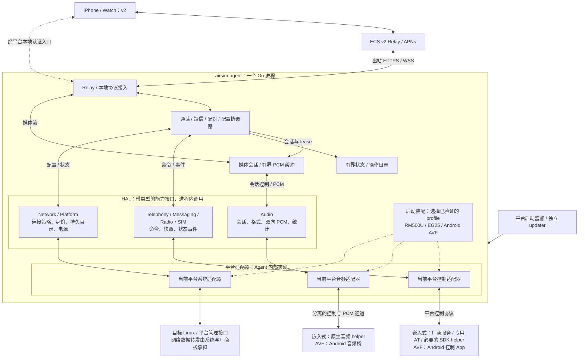
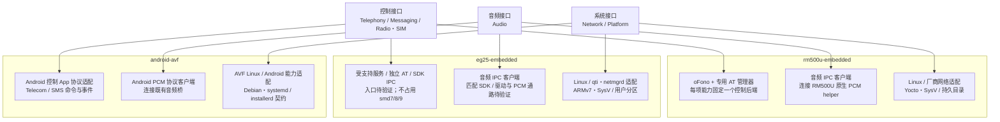

# AirSIM 多平台 Agent 架构：RM500、EG25 与 Android AVF

日期：2026-10-24。状态：整体为目标架构，RM500 新 Agent 的 R1 只读阶段已开始实施；其冻结范围见 [主控执行决策](../docs/RM500_AGENT_EXECUTION.md)，实际验收见 [R1 记录](airsim-agent/R1_TESTING.md)。基线：仓库提交 `8205e26`；本轮 RM500U-CN 的 CGMR 完整固件版本为 `RM500UCNAAR01A18M2G_01.001.01.001`。后续通话、短信、媒体、云端与永久部署不能由只读就绪推定完成。

用户已确定：新程序名为 `airsim-agent`，源码独立放在 [`module/airsim-agent/`](airsim-agent/README.md)。旧 `module/module-agent/` 保留为 v1，不原地改造、不搬空旧目录。新 Agent 首版连接 ECS v2 服务；App 通过显式 v1/v2 选择保留旧链路。下文旧源码链接是调查证据与可复用逻辑的参考，不是新实现的落点。

本文聚焦模块内部的 Agent/HAL。个人多模块、浏览器初始化与激活、自托管 ECS Relay、App 目录和在线 OTA 的产品级边界见 [系统架构与场景对抗审查](../docs/SYSTEM_ARCHITECTURE.md)。所有权按用户确认的“一个用户、多个模块、不共享”设计。

## 1. 决策

采用 **模块化的 Go Agent + 按能力划分的 HAL + 独立音频设备进程 + 独立更新入口**。

Agent 继续用 Go。通话、短信、配对、云端控制、配置和状态在一个 Agent 进程内以包和接口分开。RM500/EG25 的本机音频设备访问需要独立故障隔离；AVF 复用 Android 侧已有的音频桥进程。更新程序需要独立于被更新服务。其余功能暂不拆成常驻微服务。

**范围边界：RM500 CLI 是独立工具，有自己的实现、构建、发布与 skill，不属于新 airsim-agent。** 本设计独立建设新 Agent；不建立两者之间的运行依赖、共享设备库或管理协议，也不规划通用 CLI。已有实机诊断结果仅作为硬件能力证据。

RM500、EG25、Android AVF 均为正式支持目标，共享业务核心与外部协议。用户已明确 RM500 和 EG25 的 Agent 均运行在模块内部；AVF 的 Agent 运行在 Android 的 Linux 虚拟机内。当前 RM500 实测样机为 RM500U-CN，其他 RM500 变体需独立适配。Android Standalone 的 Java 实现继续保留：共享协议与契约测试，不强求它运行同一份 Go 进程。旧 QDC507 特有恢复逻辑保留平台边界，不进入 RM500 构建的正常路径。新连接样机自报 QDC507 项目，可评估复用对应旧适配，但必须核对当前固件与驱动 ABI，不能仅凭项目名直接执行旧恢复逻辑。

第一版范围：每个模块一张活动 SIM、一个由 AirSIM 管理的语音会话、通话/短信/网络状态、ECS v2 控制协议和复用现有 PCM 格式的媒体适配。eSIM 下载、复杂路由策略、GNSS、5G 强制选网均作为独立能力逐项验收。旧 Worker 的 v1 接入不作为新 Agent 首版前提。

## 1.1 三个正式目标与装配方式

| 目标 | Agent 运行位置 | 控制适配 | 音频适配 | 部署适配 |
| --- | --- | --- | --- | --- |
| RM500 | 模块内部 Linux；当前已测 RM500U-CN | 当前固件 oFono + 专用 AT + Linux | 当前固件原生 PCM helper；节点和采样率需验证 | 当前 Yocto/SysV、只读 rootfs、用户分区发布与回滚 |
| EG25 | 模块内部 Linux；当前已查 EG25G_QDC507、ARMv7 | 专用适配器访问受支持服务/SDK 或经验证的独立 AT 通道；当前控制入口待确认 | 当前无声卡，相关板级驱动未启用；先验证匹配固件的 SDK/驱动，再实现 Audio 接口 | ARMv7 构建与 SDK ABI 核对；SysV、只读 rootfs、约 15 MiB 用户分区；独立资源门槛 |
| Android AVF | Android 内部 Linux 虚拟机 | 现有 Android 控制 App 的 Telecom/SMS 队列与事件 | 现有 Android 音频桥，经授权私网连接；AVF 不直接打开手机 ALSA | 现有 arm64 Debian/systemd 与独立 installerd，保留配对/恢复流程 |

EG25 的内部 Linux/SDK 可用来自用户确认。用户已将模块名称更正为 EG25。ADB 实测样机固件项目标识为 EG25G_QDC507、版本 QDC507GLEFM21_02.004.03，按 EG25 的 QDC507 固件变体建立适配档案；具体型号后缀与 SDK 对应关系仍需核对。尚未验证它能运行当前 Go 工具链产物或获得双向通话 PCM。详见 [新连接样机检查](DEVICE_SURVEY.md)。不能把“开放开发环境”自动等同于“VoLTE 和语音采集可用”。型号后缀、固件、SDK/sysroot、目标架构、内核、libc、AT/SDK 接口及音频接线必须建立设备档案。移远公开资料也区分型号与可选音频能力，最终按目标 SDK 和实机确认。[厂商产品资料](https://www.quectel.com/content/uploads/2024/05/Quectel-Product-Brochure-V7.7.pdf)

平台配置由三个独立维度装配：`runtime`（进程在哪运行、如何启动/更新）、`device`（谁执行控制、提供事件）、`audio`（谁提供双向音频）。它们通过经过验证的组合清单绑定，不能任意混搭，也不能用“有 AT”决定整个平台类型。实例配置包含 schema 版本、设备/固件匹配规则和各能力约束；profile 只负责依赖装配，领域层不出现按型号分支。

建议正式 profile 名称为 `rm500u-embedded`、`eg25-embedded`、`android-avf`，名称本身不构成支持证明。RM500Q 等变体以后用独立 profile 接入，不借用 RM500U 的驱动和恢复逻辑。

## 2. 从约束推导边界

| 约束 | 架构结论 |
| --- | --- |
| 一个调制解调器最终只有一份实际通话状态 | 一个会话协调器负责业务状态与命令排序；不按 HTTP 路由拆通话微服务 |
| AT 响应和异步事件共用串行通道 | Agent 内一个长期运行的 AT 管理器负责读写、事务排序和事件解复用 |
| 音频必须持续按硬件节拍收发 | PCM 有独立有界队列和执行路径；不经过业务事件总线、JSON、磁盘或每帧进程调用 |
| 音频设备调用可能阻塞或崩溃 | 将原生音频访问放进独立子进程，可单独释放和重启 |
| 短信发送、拨号不能安全地任意重试 | 区分命令收到、设备接受、业务完成与结果未知；不承诺跨基带的 exactly-once |
| 无线链路可能中断，模块仍需可控 | 本地状态和诊断不依赖 Relay 在线；云端为接入适配器 |
| 设备资源有限，控制面没有独立横向扩容需求 | 使用进程内模块和有界消息队列，不引入服务发现、消息中间件或容器编排 |
| Agent 更新失败时仍需恢复 | 更新器和启动监督必须在 Agent 之外，并保留可启动的上一版本 |

HAL 回答“不同设备怎样执行同一能力”；进程边界回答“哪里需要独立权限、生命周期或故障恢复”。两者分别设计，不把每个 HAL 接口都变成 RPC 服务。

## 3. 已核实的事实

### 源码

- [main.go](module-agent/main.go)：`main` 显式拒绝非 AndroidTelecom profile，并要求 samsung_android 音频后端；`modemAvailable := false` 使旧 AT 轮询与恢复分支不启动。HTTP、状态、设备访问、云端会话、路由管理集中在 `agent` 上。
- [runtime_profile.go](module-agent/runtime_profile.go)：只有 android-avf 和 qdc507；未知 profile 回退为 android-avf。新设计要求未知设备配置启动失败，不静默选另一设备。
- [voice_backend.go](module-agent/voice_backend.go)：目前只有三星私网 PCM 和旧 QDC507 端点；它是后端配置选择器，尚不是完整音频 HAL。
- [calls.go](module-agent/calls.go)、[sms.go](module-agent/sms.go)、[cloud_call.go](module-agent/cloud_call.go)：业务路径直接选择 Android 或 AT，云端控制也包含平台分支。
- [at.go](module-agent/at.go) 有进程内锁、常驻 URC 逻辑，尚缺进程间端口独占；需要在 Agent 内完善资源所有权和重连契约。
- [voice_runtime.go](module-agent/voice_runtime.go)、USB/ECM watchdog 包含旧硬件的驱动、sysfs 和 ecm0 假设，不能通过替换 `/dev` 路径复用。
- [cloud_call.go](module-agent/cloud_call.go) 已有 PCM 分帧、AIRSIMPCM1 握手、会话 generation 与恢复逻辑；[cloud_command.go](module-agent/cloud_command.go) 有命令缓存和过期检查。这些机制值得提取，但当前业务/设备耦合需拆开。
- [avf-installerd](avf-installerd/system_backend.go) 的安装后端依赖 dpkg/systemctl，不能直接用作 RM500 安装器。
- [Android VoWLAN 网关](../android/phone-control-app/src/com/airsim/phonecontrol/VoWLANGatewayService.java) 承担本地入口；RM500 没有这个 App。iOS 仍存在 moduleLocal 的旧地址分支，不能假设更换设备后本地通信自动兼容。

### RM500 实机快照

| 项目 | 当前观察 |
| --- | --- |
| 系统 | ARM64，Linux 4.14.98，Yocto unisoc-initgc |
| Linux 可见总内存 | 197,284 KiB，约 192.7 MiB；不是芯片物理 RAM 标称值 |
| 检查时可用内存 | 约 93 MiB，随厂商服务、网络与通话变化 |
| 用户分区 | 35,664 KiB 总量、26,232 KiB 可用，UBIFS；这是文件系统报告值，不等于未压缩发布包可用容量 |
| 根分区 / 启动 | 根 UBIFS 只读；PID 1 为 init，存在 SysV init 脚本；没有 `/etc/systemd/system` |
| 厂商服务 | RIL、oFono、AT router、audiohal、quec-voice；应保留其基带与音频路由职责 |
| 已验证 | 专用 AT `/dev/smd1`、蜂窝数据、呼出接通与挂断、模块测试音可被远端听到 |
| 尚未验证 | 持续双向语音清晰度、静音残留原因、来电/短信全流程、重启后的服务恢复 |

详见 [RM500 实机诊断记录](rm500/cli/TESTING.md)。该记录来自独立诊断工具，不代表 Agent 已实现相应能力。本次检查只查询设备，没有部署 Agent、修改启动配置或拨号。

本次尝试在主机进行现有 Agent 的 ARM64 静态构建，但被主机 GOPROXY 配置和缺失的 euicc-go 依赖阻断，未得到产物尺寸或运行时内存数据。不能据此声称原 Agent 已可部署；编译与资源测量列为第一阶段门槛。

### EG25 在线实机复核与架构审查

2026-10-24 再次通过 ADB 只读复核，固件仍为 EG25G_QDC507 / QDC507GLEFM21_02.004.03。完整证据和检查边界见 [EG25 设备审查](DEVICE_SURVEY.md)。EG25 已纳入设计目标；当前代码和设备尚未完成 EG25 运行验收。

| 实测事实 | 对设计的要求 |
| --- | --- |
| 单核 ARMv7 / Cortex-A7、VFP/NEON；Linux 3.18.44；厂商 ELF 为 32 位小端 ARM EABI5 | Agent 候选构建为 `CGO_ENABLED=0 GOOS=linux GOARCH=arm GOARM=7`；实际运行待测。原生 helper 必须匹配厂商 SDK 的 libc、浮点调用 ABI 与固件，不能使用 ARM64 产物 |
| MemTotal 43,460 KiB，复核时 MemAvailable 16,120 KiB；内核未启用 swap | 以 Go 基础运行、TLS/Relay、设备控制、双向媒体逐步测量整机峰值；不能套用 RM500 的 32/48 MiB 预算，不能以 swap 兜底 |
| userdata 总 15,712 KiB、可用 15,496 KiB；/data、/cache、/usrdata 是同一分区 | 只能计算一份容量；发布包、回滚和 staging 必须实测可容纳，否则该更新布局不能启用 |
| 根 UBIFS 只读；/var/lib、/run 为 tmpfs | EG25 显式使用 `/usrdata/airsim` 作为持久目录候选，不能继承 `/var/lib/airsim`；启动 hook 需固件/SDK 集成及断电验证 |
| ql_manager_server 占用 smd7，remotefs 占用 smd8，UART 桥占用 smd9；旧 `/dev/airsim_data11` 不存在 | 保留厂商服务所有权；先确定受支持的命令与事件入口，不能仅更换旧 Agent 的端口路径，不能将空闲节点自动判为 AT |
| 无 ALSA 声卡/PCM 节点；内核未启用 `CONFIG_SND_SOC_MDM9607`、`CONFIG_SND_SOC_QDSP6V2`；已安装 modules.dep 未列出对应音频模块 | 音频驱动/SDK 是前置依赖，业务重构本身无法补足。没有声卡不等于硬件不支持；当前 Audio 为验证未完成、不可就绪 |
| ecm0、rmnet0、rmnet_data0/1、bridge0 存在；qti/netmgrd 正在运行 | 网络由 EG25 厂商栈管理；不引入 RM500 connman/oFono 假设。接口存在不代表蜂窝数据、IMS 或 VoLTE 已验证 |

原 QDC507 实现可作为驱动接入线索：它需要 DATA11 桥、`qdc507_aprv3.ko`、`qdc507_voice.ko`、校准和原生 PCM helper。当前检查未找到这些运行条件；同为 3.18.44 或同名项目不能证明模块 ABI 兼容。复用前需要对应内核构建配置/符号、SDK、固件匹配和可恢复的独立驱动验收。常规 Agent 启动不得尝试未知驱动加载或 USB 重枚举来“修好”设备。

## 4. 总体架构与三平台 HAL

### 4.1 业务、HAL 与进程边界

下图是重构目标。HAL 和平台适配器都在同一个 Go Agent 内；框外才是厂商服务、原生 helper、Android 侧组件和独立更新入口。每次部署只装配一个平台组合。



实线表示运行时调用或数据流；profile 的虚线表示启动时依赖装配，不是另一个服务，也不是通话期间的后端切换。HAL 中的控制事件与 PCM 分开传递，PCM 不经过业务事件队列。EG25 如需 C SDK，可将其适配与音频合入同一个原生 helper，图中的两个外部职责不强制对应两个进程。

本地认证入口由平台提供：RM500/EG25 计划在 Agent 内实现，AVF 保留 Android App 网关。嵌入式本地链路尚待验收；RM500 的 USB RNDIS 存在不代表 iPhone 已能接入，也没有证据证明它自带 Wi-Fi。第一阶段使用 ADB/本机管理，随后先接云端，再按实际 USB/LAN 网络实现本地通信。

### 4.2 HAL 能力到三平台的映射

下面三列是可选适配组合，均为 Agent 内部代码模块；每个实例只加载匹配的那一列。原生 helper 和 Android App/音频桥通过第 4.1 节所示的进程边界连接。



图示表达设计映射，不表示所有能力已经就绪。EG25 的控制入口、Go 资源预算和音频驱动仍是前置验收项；AVF 的 Radio/SIM、宿主网络或电源能力以 Android App 实际开放范围为准。未提供的能力显式报告不支持或尚未实现，不通过 VM 直接访问手机 AT/ALSA。启动、更新与回滚由各平台独立部署组件执行，System adapter 只暴露相应的平台能力与状态。

### 进程责任

| 组件 | 所有权与生命周期 |
| --- | --- |
| airsim-agent | 一份业务状态、设备适配器、命令调度、身份配对、Relay 与本地认证入口；长期运行 |
| airsim-audiod | 仅拥有音频会话期间使用的 PCM handle、必要的会话路由和重采样状态；由 Agent 按需启动并监督 |
| updater / launcher | 校验发布包、激活版本、健康检查、回滚；更新器按需执行，稳定 launcher 在固件启动阶段被调用 |
| 厂商服务 | 继续管理基带、IMS、底层音频与既有网络；不作为 AirSIM 的子进程，不因 Relay 断开而重启 |

RM500U 的音频 helper 优先采用小型 C/TinyALSA 实现以贴合厂商音频 ABI；EG25 使用对应 SDK 的音频 API/ABI 实现同一 IPC 契约。两者分别用配套 SDK/sysroot 构建和验证。Go Agent 保持 CGO=0。这是原生设备访问的隔离选择；若后续必须全部 Go，可替换 helper 实现，协议与业务核心不变。现有 tinycap/tinyplay 继续用于诊断和早期验证，不将反复启动它们作为正式通话媒体实现。

EG25 控制能力优先采用已有受支持 IPC 或独立 AT 接口。若必要能力只通过厂商 C SDK 暴露，则将这一小段 ABI 适配放入平台原生 helper；可与该平台音频 helper 合并为一个原生进程，控制和 PCM 通道仍分开。它只执行设备操作和上报事件，业务状态、授权和重试决策仍由 Go Agent 负责，不按通话/短信/网络再拆服务。最终是否需要这一适配取决于 SDK 验证，当前仅发现厂商库文件，尚未验证其接口契约。

## 5. Agent 内部 HAL 与代码边界

HAL 暴露带类型的能力和事件，而非一个无限扩展的 `ExecuteAT(string)`。

| 接口 | 操作 / 事件示例 | RM500U 后端 | EG25 后端 | Android AVF 后端 |
| --- | --- | --- | --- | --- |
| Telephony | Snapshot、Dial、Answer、Hangup、DTMF；CallAdded/Changed/Removed | 优先 oFono；不足时选择经过验证的 AT 后端 | 经验证的服务/SDK 或独立 AT；入口待确认 | Android App 的 Telecom 命令、结果与事件 |
| Messaging | List、Send、Delete、Subscribe；Received/Delivery | 探测 oFono，否则专用 AT/PDU；只选一套收发策略 | 服务/SDK 或独立 AT/PDU；短信事件模型待验证 | Android App 的短信命令与事件；逐项核对能力 |
| Radio / SIM | Signal、Registration、IMS、RAT、PDP、SIM 状态 | 专用 AT 管理器 | 厂商服务/SDK 或独立 AT；不能抢占 smd7/8/9 | Android App 实际提供的状态与操作；不直通 AT |
| Audio | OpenSession、Close、Formats、Stats；双向 PCM | 原生 helper IPC，隐藏 ALSA 节点 | 匹配驱动/SDK 的 helper IPC；当前通路未就绪 | 既有 Android PCM 桥协议客户端 |
| Network | Interfaces、Routes、Connectivity、配置计划 | Linux 与厂商网络接口；先只读 | Linux 与 qti/netmgrd 等厂商栈；所有权与写接口待验证 | VM 网络；宿主蜂窝/热点仅通过 Android 已开放能力 |
| Platform | 身份、时钟、持久目录、电源、启动与更新能力 | RM500U profile / Yocto・SysV；独立 launcher/updater | EG25 profile / ARMv7・SysV / 持久用户分区；独立 launcher/updater | AVF profile / Debian・systemd；既有 installerd；手机电源不由 VM 直接控制 |

以上是建议的契约名称，不是已经存在的代码。完整接口还应规定 deadline、取消语义、错误类别、返回的操作 ID、事件排序及重新同步方式。

**RM500U 后端是组合适配器。** 呼叫控制优先使用厂商 oFono 的对象和事件，因为它已与 RIL 集成。先完成当前固件的 Dial/Answer/Hangup/DTMF/来电与服务重连契约测试，再确定生产选择；不能仅凭 GetCalls 成功推定其他方法都可用。oFono 文档定义了快照和 CallAdded/CallRemoved 事件，实际对象与方法仍以固件为准。[oFono API](https://kernel.googlesource.com/pub/scm/network/ofono/ofono/+/0.31/doc/voicecallmanager-api.txt)

如果必须使用 AT 控制、oFono 观察，两者只能作为同一个 RM500U Telephony adapter 的内部实现：一个命令入口、一份归一化状态、显式关联 modem/SIM/call。禁止两条控制链路独立重试；禁止通话中自动切换后端。`/ril_0` 通过发现与设备绑定确定，不写死为跨设备契约。

每项能力分别描述：`support=unknown|supported|unsupported`、`readiness=ready|unavailable|degraded`、原因、约束与实测证据。例如通话控制 ready 可以同时伴随 full_duplex_audio 的验证未完成；临时无 SIM 不是硬件不支持；静态 schema 不作为能力探测结果。

建议代码布局：

```text
module/airsim-agent/
  cmd/airsim-agent/            # 配置、依赖装配与生命周期
  internal/hal/               # 能力、快照、事件、错误与设备操作契约
  internal/at/                # 单读循环、事务队列、URC 分发、端口锁
  internal/calls/              # 会话状态与控制权
  internal/messaging/
  internal/media/              # 媒体会话、既有 PCM 网络协议
  internal/transport/          # Relay、HTTP/本地认证、受限健康与诊断接口
  internal/store/
  internal/platform/rm500u/   # oFono、AT 与 Linux 的组合适配
  internal/platform/eg25/     # EG25 内部 SDK/AT/服务与事件适配
  internal/platform/android/  # 现有 Android 命令队列与事件适配
module/rm500/audio/            # audiod 与 IPC 契约
module/rm500/packaging/        # Yocto 集成、签名 manifest、launcher
module/eg25/audio/             # EG25 专用原生音频实现
module/eg25/native/            # 仅在必须使用厂商 C SDK 时增加；可合入同一个 helper
module/eg25/packaging/         # EG25 SDK/固件集成与发布
module/packaging/              # 保留 Android AVF Debian 发布
module/avf-installerd/         # 保留 AVF 独立安装和恢复
```

这是新建工程的目标布局，不搬动旧实现。经主控指定后，可把已验证的纯逻辑及对应测试移植到新工程，保留来源与行为证据；不通过运行旧 Agent 或导入旧 main 包实现新架构。接口由实际调用需求驱动；eSIM 从开始就作为可选构建模块，避免普通通话构建被未使用的 LPA 功能牵连。

HAL 和设备适配器由新 airsim-agent 自己维护，供三种 Agent 部署共享业务核心。能力接口服务于 Agent 的业务需求，设备细节封装在各平台适配器中。源码可与旧 Agent 并存，但同一硬件不能同时运行两代控制进程；新构建、发布标识、配置和状态目录必须明确区分代际，不能因二进制同名覆盖旧安装。

## 6. Agent 与厂商服务的资源所有权

- RM500/EG25 只在需要直接 AT 的适配器中建立 AT 管理器；SDK/厂商服务拥有端口时，通过其受支持接口访问。AVF 不创建 AT 管理器。
- Agent 的 AT 管理器在打开专用端口的整个生命周期持有按设备号确定的进程间锁，只有一个 reader 分流命令响应与 URC。锁用于参与同一锁约定的进程间互斥，不能保证阻止任意程序打开端口。
- 迁移期间禁止新旧 Agent 同时拥有设备。外部工具需要直接控制同一 AT、通话或音频资源时，先停止 Agent 并确认资源释放；维护结束后 Agent 启动时重新读取设备状态。这是硬件使用约束，不建立工具与 Agent 的软件依赖。
- 业务中只选择一个 Telephony 写入者；所有控制经过通话或配置协调器，常规业务入口不暴露任意原始 AT 写入。
- oFono/RIL 仍拥有自己的端口。AirSIM 的 flock 无法约束厂商程序；只使用已确认专用的 AP AT 端点，避免抢占它们的通道。
- EG25 当前固件的 ql_manager_server、remotefs、UART 桥分别持有 smd7/8/9；适配器不得打开这些通道。厂商服务的 socket 也必须先确认协议、访问权限和事件模型，不能根据文件名试发命令。
- 所有会改变注册或连接的 Radio/SIM/USB 操作经过配置协调器；通话期间默认返回 busy，除非用户明确要求结束通话执行维护。长 AT 事务一旦发送不能假装可抢占；通话期间不启动运营商扫描、LPA 或网络重配置。

## 7. 状态、并发与失败语义

### 通话

以串行事件循环维护每个 modem 的通话协调状态。业务发出的期望状态与设备观察到的实际状态分开：收到拨号请求 → 请求已提交 → dialing/alerting → active → ending → ended。硬件快照和事件决定实际状态，AT OK 不直接生成 active。

统一维护内部 `session_id`、设备调用标识、外部 call_id/call_uuid、generation、所有者、固定 transport、媒体 epoch。不同入口都先做同样的合法性检查，云端媒体凭据等前提检查必须在拨号副作用之前完成。一个会话锁定本地或 Relay 传输，不在途中静默迁移。

控制任务通过有界队列交给设备工作线程，避免状态事件循环被同步 AT 等待卡住。挂断优先于新诊断任务；语音状态事件不被短信或网络扫描堵住。事件包含来源 epoch 与序号；丢事件/重连时先标记状态可能过期，再读取快照对齐，避免旧事件重新激活已结束通话。

设备重启或 Agent 崩溃恢复时，先读取当前通话、SIM 和注册状态。对无法证明归属的现存通话标记为 unmanaged，不自动补拨或挂断。新会话不能复用旧会话的媒体 lease 或命令 generation。

### 命令与持久化

每个外部命令有 command_id、截止时间、目标设备/会话和动作。HTTP、本地认证网关和 Relay 入口共用去重与授权，不能各维护一份互不相知的去重状态。

建议受限大小的操作日志记录 `prepared → dispatched → observed/result`，在必要边界 fsync，以临时文件/原子替换和校验支持断电恢复。只保留有界的命令 ID、状态和必要结果；不持久化原始 AT、PCM 或默认短信正文。配置/身份凭据使用专用 0600 文件，避免和日志混放。

基带执行与本地落盘无法组成原子事务。如果发送短信后崩溃、没有可靠提交回执，则标记 outcome_unknown 并阻止自动重发。拨号、DTMF、删除也按各自可观察性处理；不能把持久去重表描述成严格 exactly-once。RPC 取消只撤销尚未执行的请求，已提交设备的动作必须回读或返回未知。

第一版使用小型有界文件状态存储即可，不引入常驻数据库服务；如后续需要复杂查询和事务历史，再评估嵌入式数据库及闪存写放大。

## 8. 音频路径（通用会话契约、分平台实现）

RM500/EG25 在内部使用平台专用 helper；AVF 的 Audio 接口封装现有 Android PCM 握手、会话管理和统计，不重新接管 Android 的硬件节点。三者都返回明确的格式、就绪状态、会话标识和失败原因。下列 PCM 节点和 audiohal 路径是 RM500U 实例；EG25 必须先完成匹配驱动/SDK、路由与采集/注入验证，不能将这些节点写进通用 Audio 契约。

2026-10-24，RM500 新 Agent 已完成当前固件、厂商 16 kHz 语音时钟下的 75 秒本地双向内容验收：用户确认系统语音清楚且听到自己的延迟回声，helper 故障、会话重建及挂断回收通过。此结果仅覆盖本地 Agent/helper 链路，长稳、厂商 8 kHz 时钟及云端/App 端到端仍待验证；运行时 voice_ready=false 暂保留为实验发布门槛。当前有效参数和实测边界以 [R3 主控契约](../docs/RM500_AGENT_R3.md) 为准，下列各平台及网络适配描述仍为总体设计。

1. Telephony 确认会话和状态，媒体协调器取得该会话的唯一 lease，预备设备路由并在已授权的会话中启用 PCM。
2. audiod 打开专用采集/注入节点；当前候选为 hw:0,9 / hw:0,55，保留 audiohal 对 modem PCM 的管理。helper 不直接替代 RIL/audiohal，也不从“重启音频”升级成“重启基带”。
3. 控制 IPC 与音频数据 IPC 分离。控制使用带长度和大小上限的结构化消息；PCM 使用 Unix stream socket 上的定长/带长度帧、会话 epoch、序号和格式声明。第一版不需要共享内存。
4. 外部先保持现有 8 kHz、mono、S16LE、20 ms/320 字节 PCM，以及现有 AIRSIMPCM1 和 airsim-pcm-v1 兼容层。设备采集/播放可以使用不同原生速率，重采样在 Audio adapter 内完成；必须验证播放速率、音高与采样计数，不能依据“听到音调”固定硬件格式。
5. 两个方向分别预分配有界 ring buffer，建议起始播放目标 60–100 ms、队列硬上限 200 ms，作为需调优的设计值。消费慢时丢弃过期完整帧并计数，绝不无限积压。ALSA xrun 由 helper 做局部恢复；网络重连由 transport 负责，只有媒体协调器决定是否重建会话。[ALSA PCM 文档](https://www.alsa-project.org/alsa-doc/alsa-lib/pcm.html)
6. 正常静音会持续产生合法帧，不能仅凭 RMS 小判定故障。分别观测设备帧进展、网络帧进展、xrun、队列长度、时钟漂移与音量。当前静音残留需要受控实时信号和双向监听定位。
7. 挂断、控制 socket 关闭、lease 超时或父进程退出时，helper 释放它自己的 PCM handle、队列及会话路由。恢复预算有上限，失败后向客户端报告媒体不可用；基带通话是否结束由业务协调器依据会话归属和超时策略决定。

PCM 在该格式下每方向约 16,000 字节/秒，双向 32,000 字节/秒；这只计载荷，不含 TLS/帧头。Unix socket 带宽不是当前主要瓶颈，时序、硬件路由和蜂窝抖动更关键。WebRTC/Opus 作为未来媒体适配器，通过能力协商接入；本轮不同时改变音频硬件实现和外部媒体协议。

## 9. 协议、安全入口与网络职责

- 新 Agent 以 v2 为云端主入口，明确区分 user_id、module_id 与 client_installation_id。复用既有 command_id、通话代次与 PCM 的可靠机制不等于复用旧身份。旧 `/api/*` 与 v1 云端链路继续由旧栈承载；新 AVF adapter 必要的 Android 本地接口兼容单独验收。任何额外 v1 兼容入口需主控另行定义，目标不唯一时拒绝执行。身份与迁移规则见系统架构。
- 内部控制只监听 Unix socket 或必要的 loopback。不要将旧 Agent 的 `0.0.0.0:8575 + 私网地址过滤` 直接复制为 RM500 对外鉴权。
- 本地手机入口需要独立配对、请求认证、时间窗、nonce 防重放、路由白名单、请求大小限制和单会话媒体授权；可在同一 Go 进程中复用已有 VoWLAN 协议，不必单独开微服务。明确允许的接口地址，链路消失时关闭对应 listener。
- 初始化通过浏览器/本机引导完成设备密钥持有证明与账户绑定，不手工分发共享设备 Secret。模块设备凭据、App 会话、更新签名根和每通电话媒体票据各自隔离；AVF 既有配对在迁移期间由兼容适配器保留。
- Relay 保持出站 HTTPS/WSS，无需暴露蜂窝入站端口。验证 CA、设备时间、DNS 和路由后再验收 TLS；网络不通不能关闭证书验证。旧公网 DNS 回退和 SO_BINDTODEVICE 策略应作为网络策略适配，不隐式继承 QDC507 的接口排除规则。
- 通用互联网数据继续走 Linux/厂商网络、NAT 和 USB 网卡。Agent 管理数据连接与策略，不将所有上网流量转发进 Go。
- 网络配置先生成差异计划，再由 RM500 后端应用，和厂商 connman/NAT 管理者明确所有权。默认不启动旧 router.reconcile、ECM 修复或 RF 复位循环。

## 10. 部署、资源与更新（以下目录和预算为 RM500 实例）

EG25 使用同一签名 manifest/健康与回滚契约，其目录、分区、启动器和二进制 ABI 绑定实际固件。AVF 保留原有 Debian/systemd/独立 installerd 路径，不迁移为 RM500 用户分区布局。三个目标不共享可执行二进制，只共享源码、业务协议和发布校验逻辑。

EG25 当前样机使用 `/usrdata/airsim` 作为持久安装目录候选；profile 必须显式设置 `AIRSIM_DATA_DIR` 并核对挂载，拒绝把身份、状态和回滚文件写进 tmpfs 的 `/var/lib`。`/run` 只保存瞬时状态。升级包通过有界缓冲流式写入持久 staging，避免整包放进 `/tmp`、`/run` 或内存；这些 tmpfs 消耗同一份紧张 RAM。SysV launcher 需通过固件/SDK 接入厂商服务就绪顺序，不能认为写入 userdata 就会自启动。最终目录布局以空间验收结果为准。

建议持久目录：

```text
/mnt/data/airsim/
  releases/<version>/         # agent、音频 helper、签名 manifest
  current -> releases/<version>
  previous -> releases/<previous>
  config/                     # 用户配置和受保护身份
  state/                      # 有界操作状态
/run/airsim/                  # socket、PID/lease、瞬时状态
```

先用 ADB 手动启动独立测试构建，只开放本机接口，并验证退出释放。之后在用户计划构建的 Yocto 固件中安装稳定 launcher/init 脚本，等待 userdata、D-Bus 与必要厂商服务就绪再启动 Agent。当前 rootfs 只读，没有证据证明存在可用的用户自启动 hook；不能将“文件放入 /mnt/data”当作自启动完成，也不为试验直接 remount 根分区。

更新采用独立程序：签名 manifest 绑定平台/架构/协议版本与文件哈希 → 检查空闲空间 → 完整 staging → 校验 → 在无活动通话时原子切换版本指针 → 启动 → 本地健康验证 → 提交版本。失败回滚到 previous。健康判据包含控制 socket、设备适配器状态与启动过程，断网时不因 Relay 不可达立即回滚。稳定 launcher 的启动失败计数写入有限状态，支持断电后的回退。第一版不自动升级 launcher 本身。

在线 OTA 的发行元数据、信任根、过期/回放防护、维护 lease 与灰度遵循 [系统架构的 OTA 设计](../docs/SYSTEM_ARCHITECTURE.md#8-在线-ota独立更新器负责最终决定)。Agent 包与整机固件分开更新；持有 Relay 管理权限不等于持有发行签名权限。

更新不复用 Android 的 .deb 包；复用签名校验、健康检查、回滚的设计与测试，再提供 RM500 后端。兼容旧状态数据才能回滚：只做可向后读取的迁移，或保留上个版本的状态快照；不能只回滚二进制。

EG25/QDC507 样机仅有约 42.4 MiB Linux 可见内存、复核时约 15.7 MiB 可用，且内核未启用 swap，无法套用下面的 RM500 预算。P0 必须先测最小 Go 常驻进程、TLS 握手/重连与厂商服务并存时的 RSS/峰值及整机可用内存；P3 再纳入原生驱动、helper 和双向媒体。内核分配、socket 缓冲和 tmpfs 占用也计入整机验收，不能只看 Go heap。若无法留出厂商通信峰值所需余量，先裁剪可选能力或调整固件资源，再继续完整功能迁移；拆成多个 Go 服务不会解决这项容量约束。当前没有证据支持完整 Agent 能常驻运行。

RM500 初始预算仅为待测验收目标：Agent 稳态 RSS ≤32 MiB、包含音频 helper 的 AirSIM 峰值 RSS ≤48 MiB、两方向应用音频队列各 ≤200 ms。Go 内存限制是软目标，不等于 RSS 或进程硬限制，原代码 20 MiB 的 runtime 限制不能作为资源保证。[Go GC 指南](https://go.dev/doc/gc-guide)

发布前必须实测至少“当前版本 + 回滚版本 + staging + 配置/状态 + 安全余量”的空间，并计入设备上其他文件的现有占用。UBIFS 的文件未压缩体积与 df/du 口径不同，不能直接相减预测升级容量。Agent 发布包只包含自己的运行组件；没有实测的容量证明就不进入自动更新。

## 11. 分阶段迁移与验收门槛

以下阶段同时覆盖三条交付线：RM500、EG25、Android AVF。每个业务模块抽取时先保留 AVF 行为，再完成 RM500/EG25 适配。可按设备可用性安排实施顺序，但 EG25 缺样机/资料时必须列为待验证，不能从完成标准中删除。能力暂未实现与硬件不支持须分别记录。

统一契约测试使用确定性 fake backend，验证事件排序、旧 generation 拒绝、取消、重复命令和恢复；随后三个目标分别跑真机矩阵。fake 通过不代表任何平台硬件验收通过。

| 验收维度 | RM500 | EG25（模块内） | AVF |
| --- | --- | --- | --- |
| 构建 / 启动 | ARM64 当前固件、只读根分区 | 当前样机 ARMv7；最小 Go 实跑、SDK ABI、SysV 与内核兼容 | 原有 Debian arm64 与 Android 私网配对 |
| 控制 / 事件 | oFono/AT、来电与重连 | SDK/内部 AT、来电与重连 | Android 队列、权限、App/VM 重连 |
| 语音 | 注入/采集、静音残留、持续双向 | 先验收匹配驱动/SDK 与路由，再验收持续双向及额外内存 | 现有 Android PCM 桥完整回归 |
| 数据 / 恢复 | 厂商网络管理及用户分区 | EG25 固件网络管理及写盘约束 | VM 网络与 Android 共享链路 |
| 更新 / 回滚 | RM500 包与 launcher | 单个约 15 MiB 用户分区容量、持久目录、SysV 与断电回滚 | 原有 installerd 签名/安装/回滚 |
| 外部协议 | 相同 Relay/iOS/Watch 业务验收 | 相同 Relay/iOS/Watch 业务验收 | 保持既有客户端兼容 |


| 阶段 | 实施内容 | 通过条件 |
| --- | --- | --- |
| P0：边界与构建 | 固定旧 Android 行为测试；修复构建环境；明确 profile；完成三端资源与固件依赖检查 | RM500/AVF ARM64、EG25 ARMv7 构建及启动探针通过；EG25 最小 Go/TLS 内存和发布空间通过；未知 profile 失败；不自动触发未验证的驱动/USB/RF 恢复 |
| P1：本机只读闭环 | 完善 Agent 内部 AT 管理器与 HAL；RM500/EG25 最小 Agent、AVF 适配回归、能力查询、状态事件和本机健康接口 | signal/注册/IMS 可用；重复 Agent 实例不能争用端口；AT/oFono 重连与快照对齐；正常退出释放资源 |
| P2：控制与短信 | Telephony/Messaging 适配、统一状态机、幂等及未知结果处理 | 授权号码呼入/呼出/接听/拒接/挂断/DTMF；短信发送/接收/去重；崩溃后不重发、不误控新通话 |
| P3：持续音频 | audiod、格式协商、双向缓冲/重采样/lease；解决静音残留 | 双向实时语音可辨识；说话/静音可解释；建议 30 分钟连续通话与 100 次开关会话，无资源累积；故障注入可恢复 |
| P4：云端闭环 | 新 Agent 对接 ECS v2 身份、心跳、定向命令和媒体授权；验证 iOS/Watch v2 模式 | 通知→接听→双向音频→挂断；过期命令/generation 被拒；断线不重复拨号；真实 TLS 与媒体测试；App v1 旧链路回归 |
| P5：本地链路和产品化 | RM500/EG25 按可用链路实现配对/认证/发现与各自固件的 SysV 启动；独立签名包和回滚；AVF 原流程回归 | 三端未配对不可控制、transport 固定；各自重启/断电恢复通过；EG25 持久状态跨重启保留且更新空间/峰值内存合格；资源和长稳测试通过 |

P2 的无媒体拨号属于诊断阶段，不向手机广告完整语音可用。P3 成功后再宣告 full_duplex_audio ready。这些次数和预算是建议的验收目标，不是已完成的测试结果。

## 12. 当前代码处理清单

| 现有内容 | 处理 |
| --- | --- |
| calls.go / sms.go | 提取领域状态与 HTTP 映射；设备命令进入 HAL；保留过期 call_id 防护和已验证的解析测试 |
| android_control.go | 封装为 Android adapter，保持旧 App 协议 |
| at.go | 提取为 Agent 内部 AT 管理器；保留已有解析与 URC 测试，补进程间独占、长期 reader、重连及事件丢失后的快照同步契约 |
| cloud_command.go / push.go | 分离 Relay wire 协议和通用命令调度；复用身份/重连/过期检查；增加跨入口去重与崩溃后未知结果处理 |
| cloud_call.go / media_health.go / cloud_pcm_buffer.go | 提取媒体网络传输、分帧与有界缓冲；设备路径经 Audio 接口；保留静音不等于断流的语义 |
| voice_runtime.go / USB / ECM recovery | 留在旧平台模块，不进入 RM500 正常运行路径 |
| router.go / gps_network.go / power.go | 通过 Network/Platform 能力开放；先实现只读，所有写入单独验收 |
| esim_lpa.go / esim_voice.go | 可选 LPA 后端，依赖 SIM/eUICC 能力验证；不阻塞基础电话构建 |
| update.go / update_status.go | 不重新启用 Agent 自更新；提取可用的纯校验逻辑到独立更新模块 |

建议第一批实现完成 P0/P1：先建立三端装配清单与公共契约，抽取 AVF 适配器并保持回归，再用 RM500 实机验证 Agent 的资源所有权、常驻状态同步和退出释放，同时完成 EG25 SDK/设备档案与适配骨架。随后三端逐项完成通话与媒体验收。只有存在独立资源压力、权限隔离或独立升级的实测需求时，才继续拆分进程。
